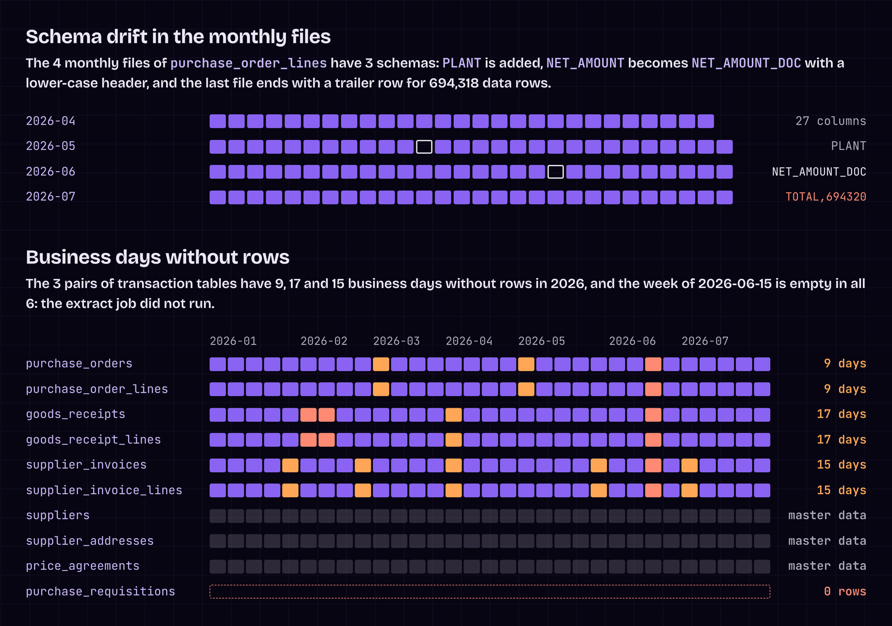
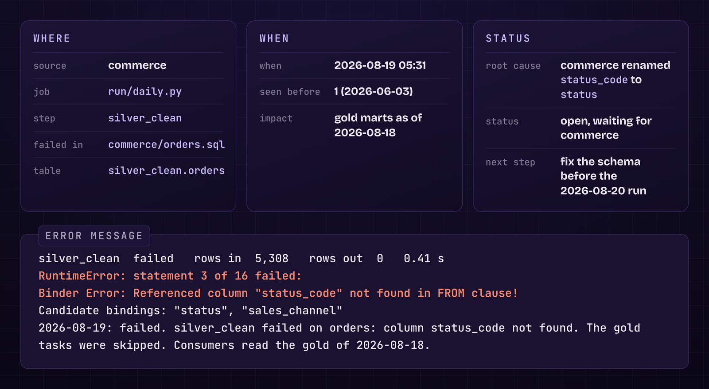
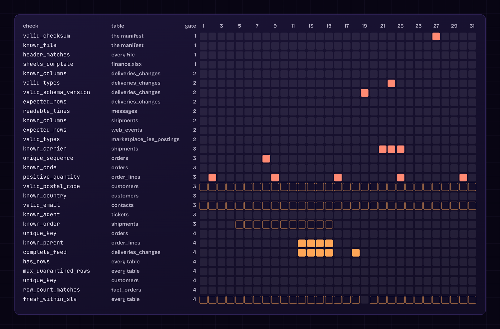
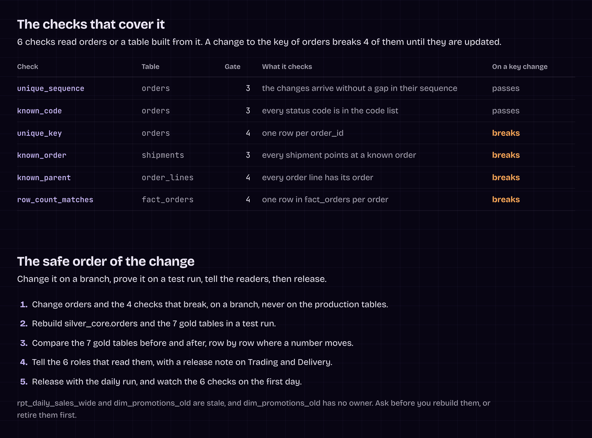
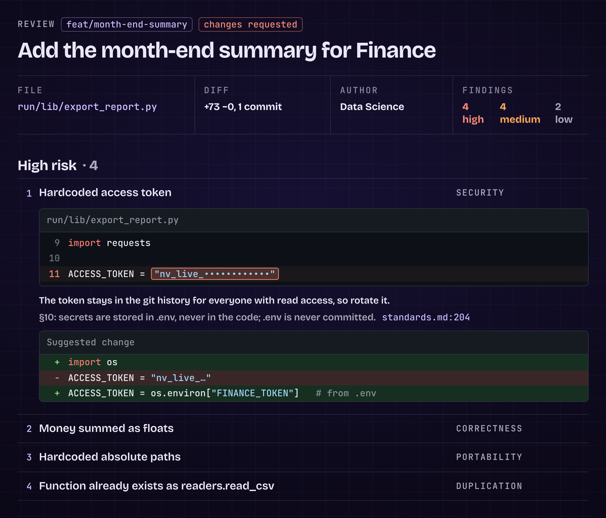
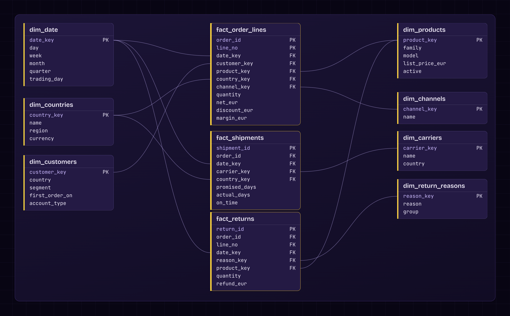
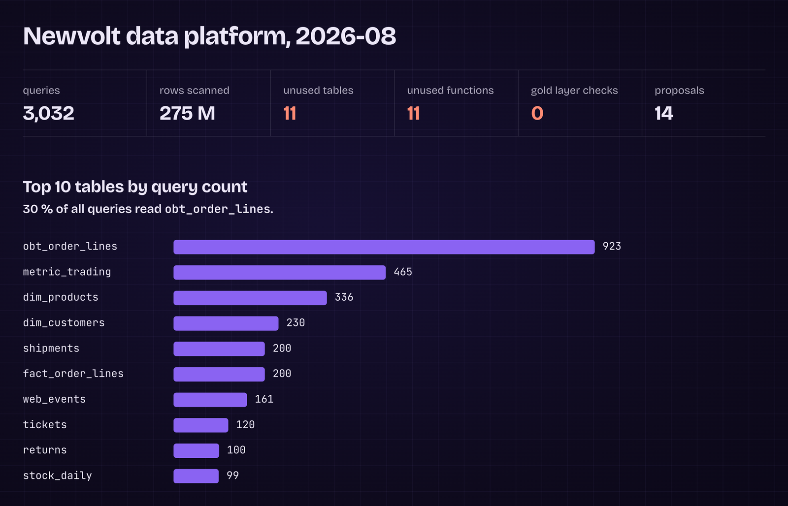
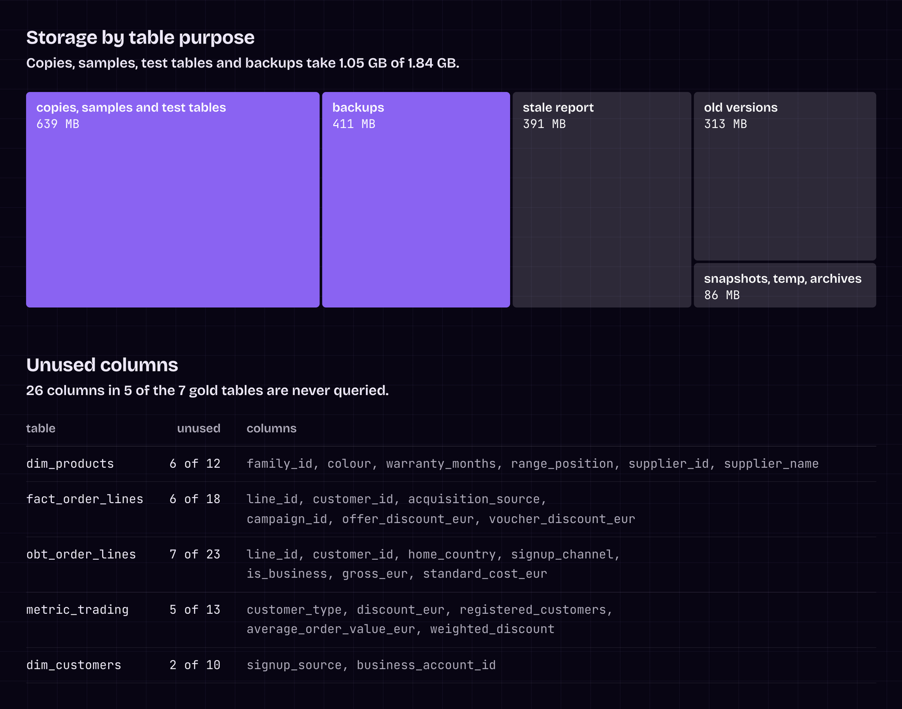

# Claude Code skills for data engineers

\
*An incident report, one of the pages these skills write.*

A toolbox of 16 Claude Code skills for the work of a data engineer beyond writing code: profiling a new source, investigating a failed pipeline, building the metadata, reviewing changes, documenting, and keeping the platform clean. Each skill is a text file that Claude Code follows the same way every time. Most of them end in a web page you can read and share.

Seven of them are the skills from the video **I Built My Own Data Engineering Tools with Claude Code** on the [Data With Baraa](https://www.youtube.com/@DataWithBaraa) YouTube channel. The other nine cover the rest of the job around them. The pictures are pages these skills wrote for a fictional company with fictional data. Most come from the video, and the impact and quality pages were made for this repo.

## Start here

1. Copy the skills into `.claude/skills/` of your data project, or install the plugin, see [Install](#install).
2. Open Claude Code in your project and type `/profile` with the folder of a new source, or `/data-engineering:profile` with the plugin.
3. Open the web page it writes. Then change the skill to fit your project.

## The toolbox

- **When new data arrives:** [profile](#profile), [contract](#contract), [metadata](#metadata)
- **When something breaks:** [incident](#incident), [quality](#quality), [reconcile](#reconcile)
- **Before a change goes in:** [impact](#impact), [test-data](#test-data), [pr-review](#pr-review)
- **When you need the big picture:** [toolkit](#toolkit), [big-review](#big-review), [cost-review](#cost-review)
- **When others use your data:** [data-product](#data-product), [docs](#docs)
- **When the project grows:** [knowledge-refresh](#knowledge-refresh), [migration](#migration)

The seven from the video: profile, metadata, incident, toolkit, data-product, pr-review and big-review.

The example pages are HTML files. On GitHub the links show their code, so download the repo and open them in your browser.

## What you need

- Claude Code, in the terminal, the desktop app or your IDE, with a Claude Pro, Max, Team or Enterprise plan, or a Claude Console account.
- Your data project in one folder: the code, the SQL, the run records, the documents.

## Install

Copy the skills into your project. Claude Code reads every skill under `.claude/skills/` of the project.

```bash
git clone https://github.com/DataWithBaraa/claude-code-data-engineering-skills.git
mkdir -p your-project/.claude/skills
cp -r claude-code-data-engineering-skills/skills/* your-project/.claude/skills/
```

To have them in every project on your machine, copy them to `~/.claude/skills/` instead.

Or install them as a plugin, inside Claude Code:

```text
/plugin marketplace add DataWithBaraa/claude-code-data-engineering-skills
/plugin install data-engineering@data-with-baraa
```

The install opens a panel where you pick the scope and confirm. Updates of this marketplace are not automatic: turn them on under Marketplaces in `/plugin`, or update by hand.

## Use

Type the name of a skill and what it needs, for example `/profile data/landing/purchasing` or `/incident 2026-08-19`. As a plugin, the name of the plugin goes in front: `/data-engineering:profile`. Or describe the task, and Claude Code picks the matching skill from its description. In the video the incident skill is called `/incidents`, here it is `/incident`.

Read a skill before you use it. Every skill says what it reads, what it writes and what it never does, so you know what it touches before it runs.

## When new data arrives

### profile

Understand new data before anything is built on it. You give it the folder of a new source. You get one page with the file formats, the schema, the data quality, the duplicates, the schema drift, the orphans, the gaps, the personal data, and the findings ranked with the decision each one needs. [Skill](skills/profile/SKILL.md) · [Example page](skills/profile/references/profile.html)

\
*The profile of one source, with the row count, the key and the missing cells of every table.*
\
*Two of the 21 findings: the schema drift between the monthly files, and the business days without rows.*
### contract

The data contract with the source system, written from the profile and the metadata: the format the source has to deliver, the schema and the keys, the quality rules, the delivery schedule, the owner, and how a change is announced. In the Open Data Contract Standard. The contract with the consumers of a table is part of [data-product](#data-product). [Skill](skills/contract/SKILL.md) · [Example contract](skills/contract/references/purchasing.odcs.yaml)

### metadata

The description of every table and every column of a source, extended from one example you wrote by hand. The names and the types come from the data with a script, and the descriptions from the documents. Where the documents say nothing, the description stays empty. Before you give company documents to an AI, check what your company allows. [Skill](skills/metadata/SKILL.md) · [Example file](skills/metadata/references/purchasing.yaml)

```yaml
source: purchasing
tables:
  - name: purchase_orders
    description: One purchase order, the header. Its lines are in purchase_order_lines.
    columns:
      - name: po_id
        type: string
        key: true
        description: The purchase order number.
      - name: supplier_id
        type: string
        description: The supplier the order went to, 8 digits with leading zeros.
```

## When something breaks

### incident

From the first error to the log entry. You give it the date of the failed run. You get where it failed, the root cause with the rows before and after, whether it happened before, the workaround for today, two solutions with their effort, the future risks, two email drafts, and the entry for the incident log. It proposes and drafts, it never fixes and never sends. [Skill](skills/incident/SKILL.md) · [Example page](skills/incident/references/incident.html)

\
*Where the run failed, when, how bad it is, and the error message.*
\
*The root cause, a renamed column, with the row before and after, and the same kind of failure found in the incident log.*
### quality

Which checks failed or warned, what was quarantined, how fresh the tables are, and a verdict for every table: safe to use, use with care, or do not use. [Skill](skills/quality/SKILL.md) · [Example page](skills/quality/references/quality.html)

\
*The verdict per table, with the reason behind each one.*
\
*Every check on every day: red is a quarantined file or row, orange a warning or skipped tasks, hollow a warning that repeats day after day.*
### reconcile

Two numbers that should agree do not. A report against its source, a rollup against its detail, two systems for the same table. It drills down until each difference sits in one slice, compares the rows, names the causes, and goes on until nothing is left. [Skill](skills/reconcile/SKILL.md)

## Before a change goes in

### impact

"If I change this, what breaks?" You give it a table, a column or a function. You get what it is built from, everything that reads it, the people who query it, the checks that break, and the safe order of the change. [Skill](skills/impact/SKILL.md) · [Example page](skills/impact/references/impact.html)

\
*A change to the core table orders: the 3 silver_clean tables it is built from, and the 7 gold tables that read it.*
\
*The checks that break, and the order to make the change in.*
### test-data

Test data with the edge cases, and the expected result written first. Synthetic rows in the source's own format, injected faults with their expected results, a second delivery with drift. Never from production data. [Skill](skills/test-data/SKILL.md)

### pr-review

One change, reviewed pass by pass against your standards: the security, the correctness, the tests, the contracts of the consumers, the portability, the duplicates, the architecture, the documentation and the style. Every finding with the risk, the file and line, the rule and the suggested change. It pushes back. [Skill](skills/pr-review/SKILL.md) · [Example page](skills/pr-review/references/pr-review.html)

\
*The verdict, and the first finding: a token in the code, with the rule and the suggested change.*
## When you need the big picture

### toolkit

The documentation site of the project, built from the repo by a site builder: the architecture, the data lineage, the call graph, the data model, the data quality, the runs and the data catalog. Rebuild it after every release and it matches the code again. [Skill](skills/toolkit/SKILL.md) · [Example site](skills/toolkit/references/index.html)

\
*The architecture, drawn from what runs, not by hand.*
\
*The star schema of the gold layer, with the keys.*

### big-review

The whole platform from the query logs and the repo: the most read tables, the slowest queries, the tables and columns nobody reads, the dead code, the storage, and proposals with the effort and the risk. It changes nothing. [Skill](skills/big-review/SKILL.md) · [Example page](skills/big-review/references/big-review.html)

\
*The month in numbers, and the most read tables.*
\
*Where the storage goes, and the columns nobody queries.*
### cost-review

Where the money goes, per job, per pipeline and per table: the top jobs, the cost per run, the storage bill, the idle spend, the spikes, and proposals with the saving per month and the risk. [Skill](skills/cost-review/SKILL.md)

## When others use your data

### data-product

Everything a consumer needs for one table: the guide, the data model, the metrics, the starter queries, the quality, the releases and the contract, on one page next to the other products. [Skill](skills/data-product/SKILL.md) · [Example page](skills/data-product/references/data-products.html)

\
*One data product, with its tabs from the overview to the contract.*
### docs

The runbook and the how-to guides of the project, written from the code and refreshed after every change, so the documentation matches the code. [Skill](skills/docs/SKILL.md)

## When the project grows

### knowledge-refresh

The knowledge Claude Code reads, CLAUDE.md, the standards, the source pages and the incident log, compared with the code and the data after a release. It proposes what is stale, missing or wrong, and you approve. [Skill](skills/knowledge-refresh/SKILL.md)

### migration

An old estate of jobs and tables that has to move: the inventory, the rating of every job, the cut list, the target, the waves, three scenarios, the acceptance numbers, the parallel run, the cutover and the rollback. [Skill](skills/migration/SKILL.md)

## What a skill looks like

A skill is one file, `SKILL.md`: the job, the input, the steps, the output, what it reads, what it writes, and what it never does. Most skills have a `references/` folder next to it with an example of the result. Claude Code reads the `argument-hint` line. Other Claude apps may not accept it, so remove that line before you upload a skill there.

```markdown
---
name: profile
description: Use when a new source or new files arrive, to profile them before ...
argument-hint: "[folder, file or table]"
---

# Profile

The job: understand new data before anything is built on it. It writes nothing but the report.

Input: the folder of the new source, a feed file, or a table.

## Steps

1. Run a profiler on what arrived, with scripts that count. Never guess a number.
2. File format: delimiter, quoting, encoding, null tokens, decimal separators, ...
3. Schema: tables, columns, data types, row counts, and the schema drift ...
...

## Output

One HTML file, like references/profile.html: the numbers on top, ...

## Reads

- the files or tables, read-only, and the metadata if there is one

## Writes

- the web page only

## Never

- Never changes a file of the project.
- Never guesses a format: a format is what the values show.
- Never shows personal data unmasked.
```

The whole file: [skills/profile/SKILL.md](skills/profile/SKILL.md).

## Make them yours

The skills are generic on purpose. Put your own paths, standards and rules into the steps, and keep the shape: steps, reads, writes, never. And when you catch yourself repeating a task, ask Claude Code to make a skill out of it, the way the video shows.

## CLAUDE.md

[CLAUDE.md](CLAUDE.md) is the instructions file from the video: how Claude Code works with you, the rules of the project, where things live, and the skills. Claude Code reads it at the start of every session. Copy it into the root of your project, then adapt the folder names and cut what does not apply to you. A plugin does not load it, your project does.

## The example pages

The pages in the `references/` folders describe one fictional company, Newvolt, with fictional data. Nothing in them is real. They come from different stages of one demo project, so some numbers and products differ from page to page.

## License

The skills, the example pages and CLAUDE.md are under the [MIT license](LICENSE): use them, change them, share them. The fonts in the `fonts/` folders are under the SIL Open Font License, see [OFL.txt](OFL.txt).
