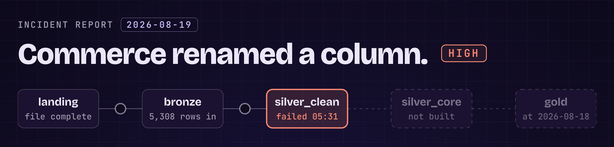
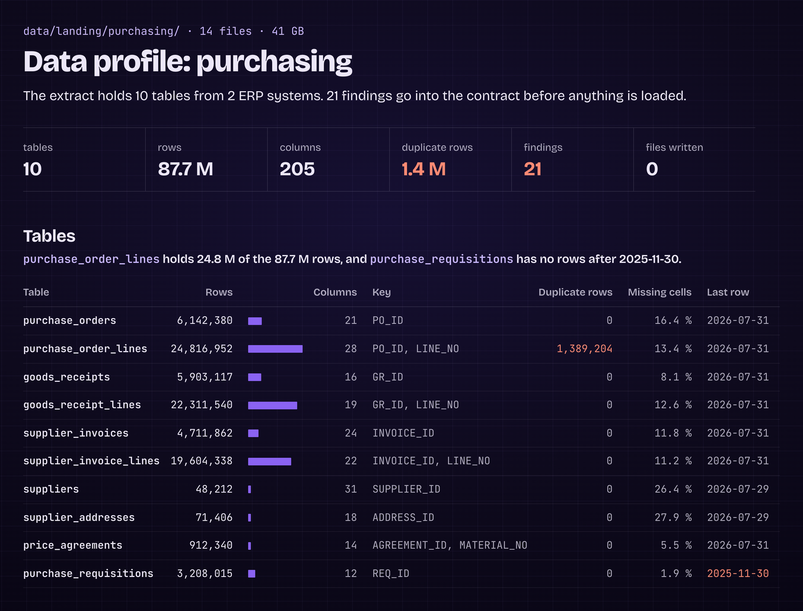
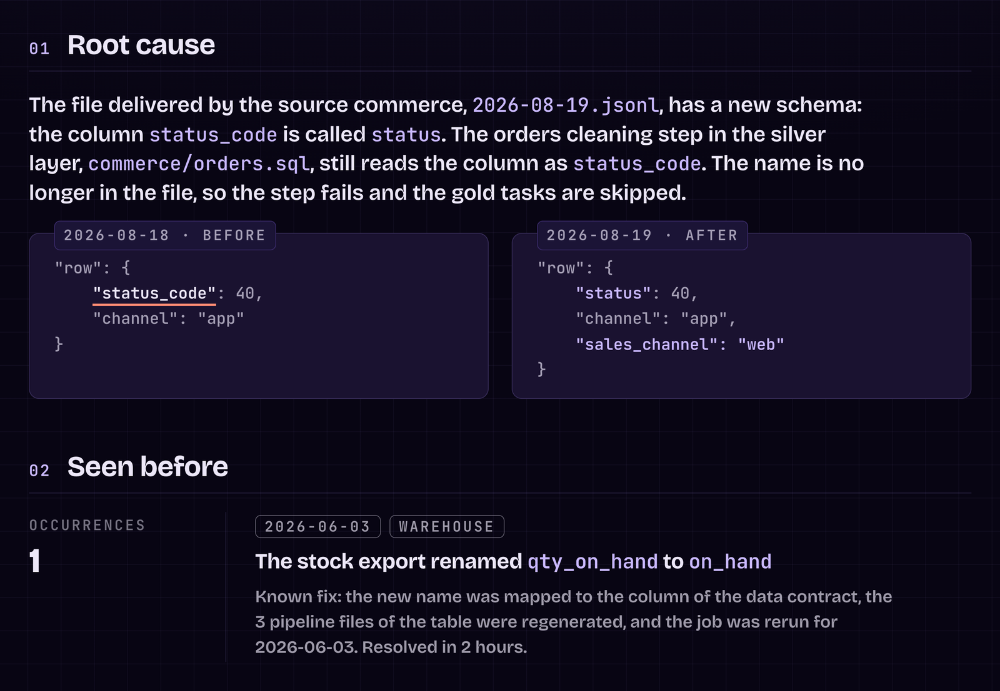
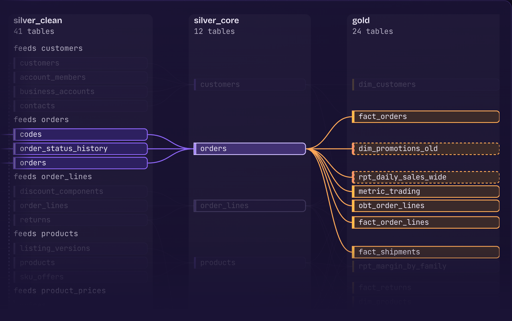
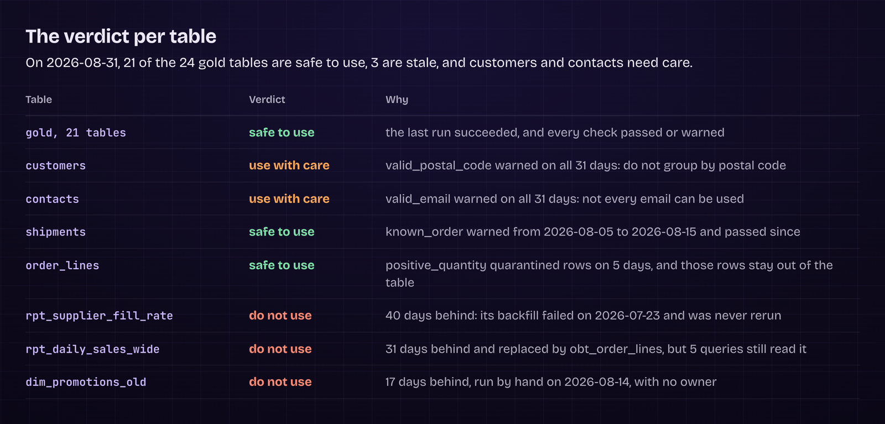
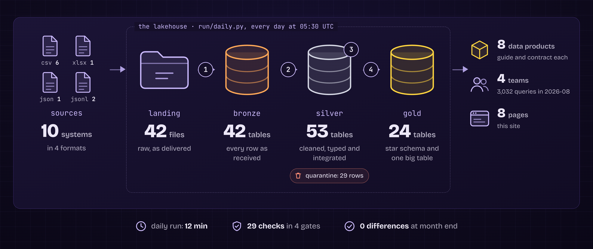
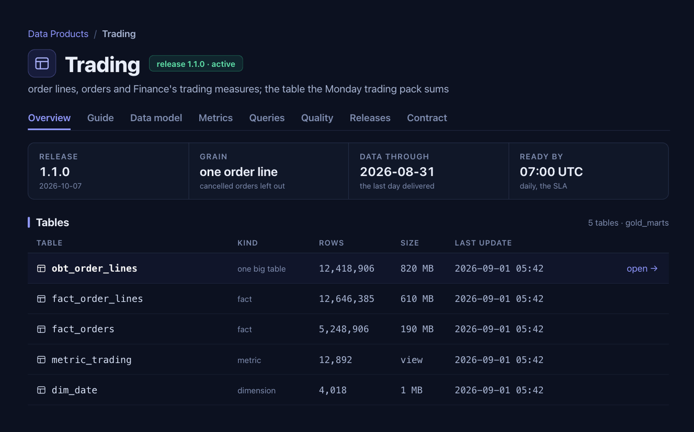

# Claude Code skills for data engineers



16 Claude Code skills for the work of a data engineer beyond writing code: profiling a new source, investigating a failed pipeline, building the metadata, reviewing changes, documenting, and keeping the platform clean. Most of them end in a web page you can read and share.

Seven of them are from the video **I Built My Own Data Engineering Tools with Claude Code** on the [Data With Baraa](https://www.youtube.com/@DataWithBaraa) YouTube channel. The example pages describe a fictional company with fictional data.

> [!NOTE]
> This is the first draft. We will expand and enhance the skills over time. Questions, ideas, or a skill of your own to share? Join the [🤖・claude-code channel on Discord](https://discord.gg/AFZet4FXF).

## Install

You need Claude Code with a Claude Pro, Max, Team or Enterprise plan, or a Claude Console account.

```bash
git clone https://github.com/DataWithBaraa/claude-code-data-engineering-skills.git
mkdir -p your-project/.claude/skills
cp -r claude-code-data-engineering-skills/skills/* your-project/.claude/skills/
```

Or install them as a plugin, inside Claude Code:

```text
/plugin marketplace add DataWithBaraa/claude-code-data-engineering-skills
/plugin install data-engineering@data-with-baraa
```

Then type a skill and what it needs, for example `/profile data/landing/purchasing` or `/incident 2026-08-19`. As a plugin, it is `/data-engineering:profile`. Read a skill before you use it: each one says what it reads, what it writes and what it never does.

To get new versions, pull the repo and copy the skills again, or update the plugin under `/plugin`. Plugin updates are not automatic.

## The skills

**When new data arrives**
- [profile](skills/profile/SKILL.md): understand a new source before you build anything on it.
- [contract](skills/contract/SKILL.md): the data contract with the source system, in the Open Data Contract Standard.
- [metadata](skills/metadata/SKILL.md): every table and column described, the types from the data, the descriptions from the documents.

**When something breaks**
- [incident](skills/incident/SKILL.md): a failed run, from the error to the root cause, the fix options, the email drafts and the log entry.
- [quality](skills/quality/SKILL.md): which checks failed or warned, and whether each table is safe to use today.
- [reconcile](skills/reconcile/SKILL.md): two numbers that should agree, where they diverge and why.

**Before a change goes in**
- [impact](skills/impact/SKILL.md): what a change to a table, a column or a function breaks, and the safe order of the change.
- [test-data](skills/test-data/SKILL.md): test data with the edge cases, and the expected result written first.
- [pr-review](skills/pr-review/SKILL.md): a pull request reviewed pass by pass against your standards, with pushback.

**When you need the big picture**
- [toolkit](skills/toolkit/SKILL.md): the documentation site of the project, built from the repo.
- [big-review](skills/big-review/SKILL.md): the whole platform from the query logs and the repo, with proposals.
- [cost-review](skills/cost-review/SKILL.md): where the compute and the storage money goes, and what to cut.

**When others use your data**
- [data-product](skills/data-product/SKILL.md): everything a consumer needs for one table, from the guide to the contract.
- [docs](skills/docs/SKILL.md): the runbook and the how-to guides, matching the code.

**When the project grows**
- [knowledge-refresh](skills/knowledge-refresh/SKILL.md): the knowledge Claude Code reads, checked against the code and the data.
- [migration](skills/migration/SKILL.md): an old estate of jobs and tables, inventoried, rated and planned into waves.

The seven from the video are profile, metadata, incident, toolkit, data-product, pr-review and big-review. In the video the incident skill is called `/incidents`.

## What they make

<table>
<tr>
<td width="50%"><br><sub><b>profile:</b> one new source on one page</sub></td>
<td width="50%"><br><sub><b>incident:</b> the root cause, and the same failure in the incident log</sub></td>
</tr>
<tr>
<td width="50%"><br><sub><b>impact:</b> what a change to one table reaches</sub></td>
<td width="50%"><br><sub><b>quality:</b> a verdict for every table</sub></td>
</tr>
<tr>
<td width="50%"><br><sub><b>toolkit:</b> the architecture, drawn from what runs</sub></td>
<td width="50%"><br><sub><b>data-product:</b> one data product for its consumers</sub></td>
</tr>
</table>

Each skill is one `SKILL.md` with the job, the input, the steps, the output, what it reads, what it writes and what it never does. Most have an example result in `references/`. Open the HTML files in your browser, because GitHub only shows their code.

## Make them yours

The skills are generic on purpose. Add your own paths, standards and rules to the steps. [CLAUDE.md](CLAUDE.md) is the instructions file from the video: copy it into the root of your project and adapt it. Other Claude apps may reject the `argument-hint` line, so remove it before you upload a skill there.

## License

MIT, see [LICENSE](LICENSE). The fonts of the example pages are under the SIL Open Font License, see [OFL.txt](OFL.txt).
